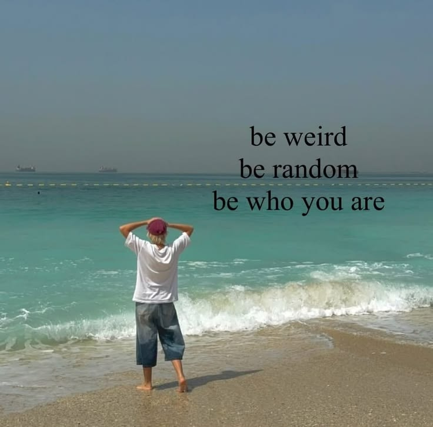

  

#

Me chamo Rafael de Paula, moro em Jacareí - SP e atualmente curso o 4º semestre de Análise e Desenvolvimento de Sistemas no IFSP. Sou apaixonado por tecnologia e IA, com foco em desenvolvimento Python, modelos de linguagem e, atualmente, expandindo para Java.
 
#

<h3 align="left">Connect with me!</h3>

<h3 align="left">My Stack ~</h3>

  
#

  

 

  <picture>
    <source media="(prefers-color-scheme: dark)" srcset="https://raw.githubusercontent.com/rafaeldevpaula/rafaeldevpaula/output/github-contribution-grid-snake-dark.svg">
    <source media="(prefers-color-scheme: light)" srcset="https://raw.githubusercontent.com/rafaeldevpaula/rafaeldevpaula/output/github-contribution-grid-snake.svg">
    
  </picture>

